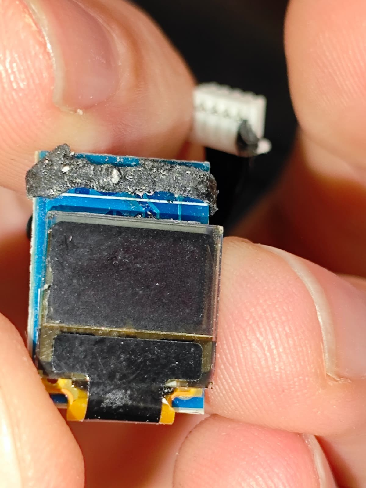
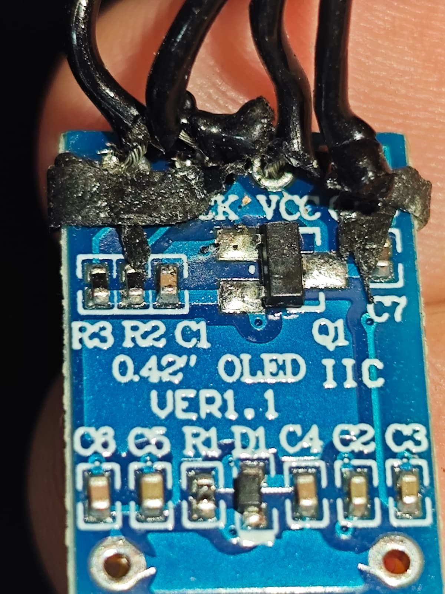
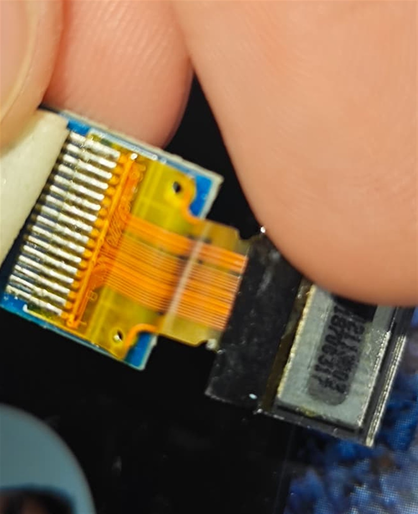

# Sustitución de la pantalla OLED

Estas fotografías son del módulo de reemplazo empleado en la reparación comunicada. La placa azul está marcada `0.42" OLED IIC VER1.1`; el flex lleva `V01870-MF1-B`. El controlador exacto no está confirmado. La pantalla original llevaba `G6_OLED_V2` y su flex estaba marcado `HP7240-01`.

## Señales y conexión

El módulo de la reparación utiliza cuatro conexiones. Conecta cada señal con su equivalente, identificando primero **ambos extremos**; el orden físico de los pads y el conector puede variar entre placas.

| Señal del gimbal | Señal equivalente del módulo | Función |
|---|---|---|
| GND | GND | Masa |
| Alimentación OLED | VCC/VDD de entrada del módulo | Alimentación; verificar tensión y compatibilidad del módulo |
| SCL | SCL / CLK | Reloj I²C |
| SDA | SDA / DATA | Datos I²C |

En este G6 Plus el usuario comprobó continuidad entre SCL y PB8 del GD32, y entre SDA y PB9. Según la interpretación comunicada por el usuario de la reparación del [post de Facebook](https://www.facebook.com/groups/SGHomeDIY/posts/9002169799856864/), **GND y VCC mantienen su posición y las dos líneas de datos intercambian sus posiciones**. Esto significa que, si ambos conectores tienen esa disposición, hay que cruzar los cables de SDA y SCL físicamente para que **SDA llegue a SDA y SCL a SCL**; no conectar SDA a SCL.

La imagen disponible del post no permite leer todos los pads ni seguir cada cable, por lo que el cruce concreto no ha podido comprobarse independientemente. El post muestra una reparación de G6 y no establece que todas las pantallas o G6 Plus tengan el mismo orden. Comprueba la serigrafía y continuidad de tu conjunto antes de soldar.

1. Retira batería y USB. Fotografía y etiqueta los cables y ambos conectores antes de desoldar; no te guíes solo por su color o posición.
2. Identifica GND, alimentación, SCL y SDA en ambos extremos mediante serigrafía, documentación del módulo y continuidad con todo desconectado. Confirma la tensión de alimentación y que sea compatible con el módulo: la tolerancia de la placa adaptadora no se deduce del controlador anunciado.
3. Si el orden de los contactos difiere, reubica o cruza **cada cable según su señal**. Suelda a los pads correspondientes del módulo sin trasladar automáticamente el orden del conector original. El número y función de los contactos del flex de 16 vías no son equivalentes a los cuatro pads externos.
4. Inspecciona las soldaduras; con todo desenergizado comprueba continuidad de cada hilo y ausencia de cortos entre pads vecinos y entre alimentación y masa. Aísla las conexiones y fija el conjunto sin presionar el cristal ni el flex antes de cerrar.

El post es una referencia de otra reparación: no se ha podido acceder a su contenido completo ni verificar sus conexiones de manera independiente.

Después de la sustitución, el parche experimental documentado en el [README](../README.es.md) resolvió el apagado parcial en un aparato. La conexión correcta de las señales y la compatibilidad de alimentación se deben verificar independientemente del firmware.
