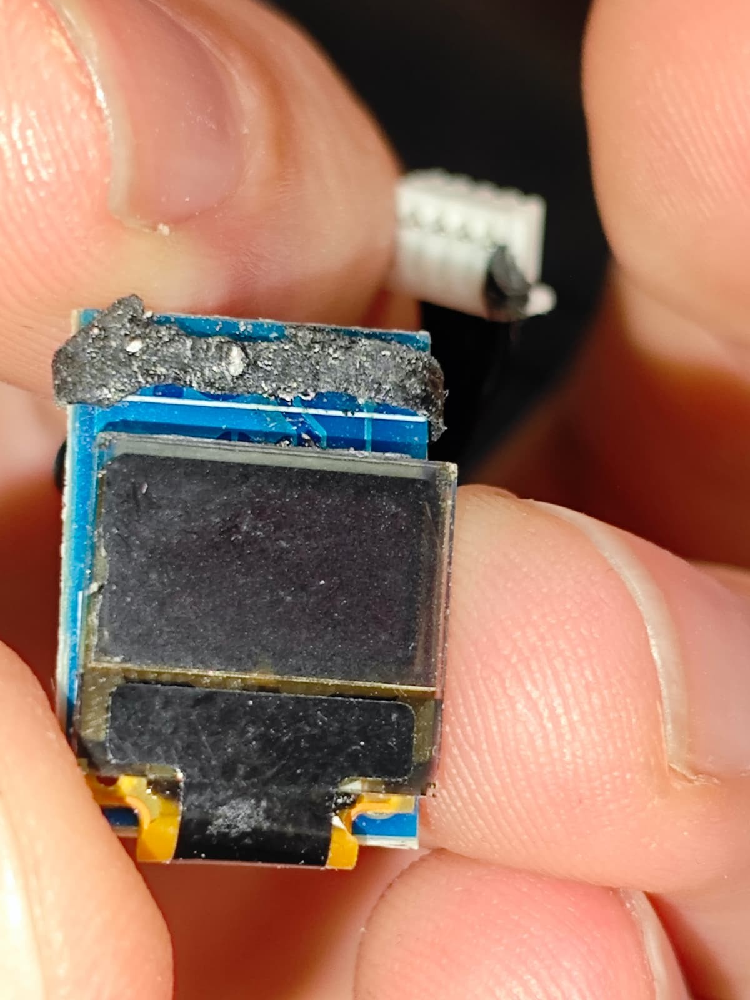
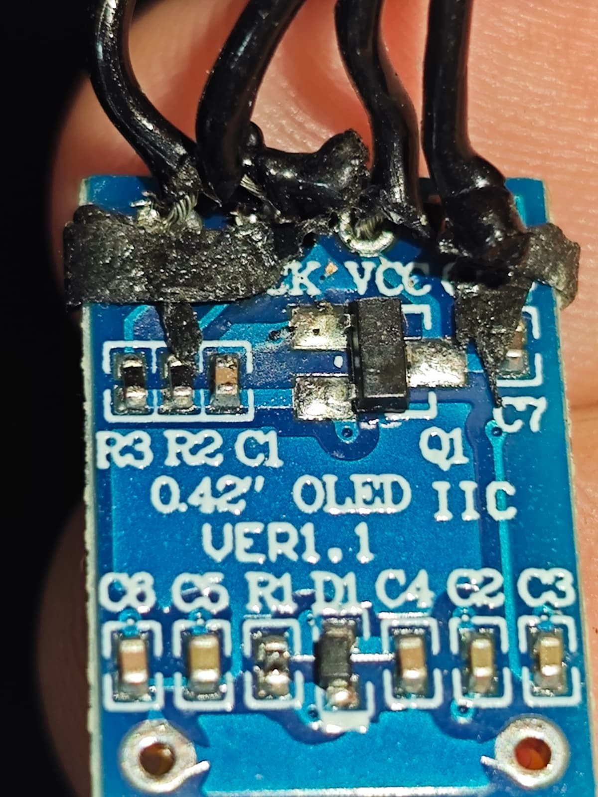
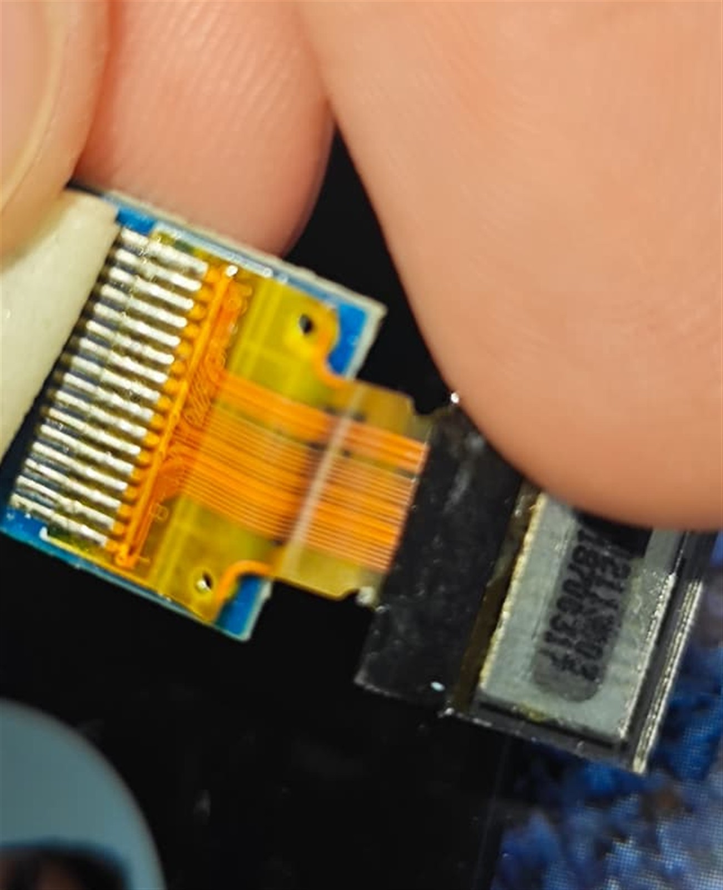

# OLED replacement and wiring

The photographs show the replacement used in the reported repair: blue board `0.42" OLED IIC VER1.1`, flex `V01870-MF1-B`. The controller is unidentified. The original display board was marked `G6_OLED_V2` and its flex `HP7240-01`.

## Wiring by signal

Connect the same signals at both ends; pad and connector order can differ between modules.

| Gimbal signal | Replacement module | Function |
|---|---|---|
| GND | GND | Ground |
| OLED supply | Module input VCC/VDD | Supply; verify voltage and module compatibility |
| SCL | SCL / CLK | I²C clock |
| SDA | SDA / DATA | I²C data |

The owner reported continuity between OLED SCL and GD32 PB8, and between OLED SDA and PB9. That does not establish the physical order of the display connector. The pictures do not show all pad labels and the original connector order and wire colors were not verified; **the exact positions that need swapping are unknown**.

1. Remove battery and USB. Photograph and label both ends before desoldering; do not rely on wire colors or positions alone.
2. Identify ground, supply, clock and data using the board labels, module documentation and continuity with all power disconnected. Check the actual supply voltage and module compatibility; a controller name does not establish the adapter board's input range.
3. If the order differs, rearrange or cross each wire according to its signal and solder to the matching pad. Do not transfer the original order blindly. The 16 flex contacts have different functions from the four external module pads.
4. Inspect solder joints. With power disconnected, verify wire continuity and check for shorts between adjacent pads and between supply and ground. Insulate the connections and secure the module without pressing the glass or flex before closing.

This [Facebook G6 repair post](https://www.facebook.com/groups/SGHomeDIY/posts/9002169799856864/) describes another repair. Its complete content and wiring could not be verified, and it does not establish this G6 Plus pinout.

The experimental patch in the [README](../README.md) resolved the partial-screen issue in one device after replacement. Wiring and supply compatibility must be verified independently of firmware.
